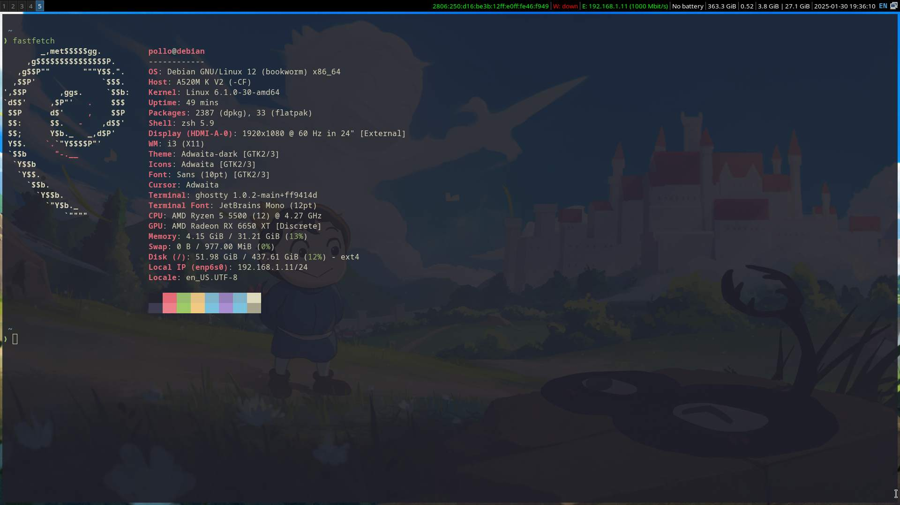

# Config files
This repository contains the configuration files for various tools and applications that I use to create a productive and aesthetically pleasing desktop environment.



## Tools

- Neovim
- i3
- Rofi
- picom
- ghostty
- zsh
- tmux
- Nitrogen
- i3status

## Installation

Clone this repository to `~/.dotfiles`, then run:

```sh
bash ~/.dotfiles/install.sh
```

The installer can be run from any directory and can be rerun safely. It creates
symlinks and their parent directories, but stops if a destination already exists
and points somewhere else. Move existing configs aside before installing.
Packages are installed separately.

### Dependencies

This setup targets Linux with X11 and i3. Install the tools you use:

- Desktop: i3, i3status, Ghostty, Rofi, picom, Nitrogen, dex, Firefox, Nautilus.
- Session integration: xrandr, setxkbmap, xset, xss-lock, i3lock, nm-applet,
  gnome-keyring-daemon, pactl, playerctl.
- Screenshots and clipboard: maim, xdotool, xclip.
- Shell: zsh, Starship, direnv, eza, brightnessctl, tmux, fzf, Git, findutils.
- Optional integrations: Syncthing, lazygit, opencode.
- Fonts: JetBrains Mono (terminal), Roboto (bar), and a Nerd Font for icons.
- Terminfo: `tmux-256color` must be available (`infocmp tmux-256color`).

The shell currently expects Homebrew at `/home/linuxbrew/.linuxbrew`.
Install [Antidote](https://antidote.sh/) before starting zsh:

```sh
git clone --depth=1 https://github.com/mattmc3/antidote.git ~/.antidote
```

### Neovim

Use Neovim **0.12+** for the current Treesitter `main` branch. First startup
bootstraps lazy.nvim and installs plugins; a network connection is required.
Treesitter installs the configured parser list asynchronously. Reopen a buffer
after its first parser installation to activate highlighting. Use `:TSUpdate`
after plugin updates and `:TSInstall <language>` for additional languages.

Parser builds need a C compiler, `tar`, `curl`, and `tree-sitter-cli` 0.26.1+
(install the CLI through a system package manager, not npm). Telescope's native
fzf extension also needs `make` and a C compiler; install `ripgrep` and `fd` for
searching.

Use `:Mason` to install the language servers you need: `lua-language-server`,
`pyright`, `ruff`, `gopls`, `clangd`, `typescript-language-server`,
`biome`, `css-lsp`, `tailwindcss-language-server`,
`svelte-language-server`, and `astro-language-server`. Their runtimes (such as
Node.js, Python, and Go) must also be installed as needed.

Formatting uses Conform for saves, `:Format`, and `<leader>ff`. Install the relevant
executables through Mason or your package manager:

- Lua: `stylua`.
- Python: `ruff`.
- Go: `gofumpt`, `goimports-reviser`, `golines`.
- JavaScript/TypeScript: `biome` (project-local binaries are supported).

When no configured formatter is available, Conform falls back to an attached LSP
formatter. `:ConformInfo` shows formatter availability.

## Machine-specific settings

For a custom monitor layout, create `~/.config/i3/autostart.local.sh`:

```bash
#!/usr/bin/env bash
xrandr --output HDMI-1 --auto --right-of eDP-1
```

This file is sourced on i3 startup/restart instead of the default HDMI-2/eDP-1
mirroring. The default only runs when both outputs are connected. The local
file is ignored by Git if created in the repository's i3 directory.

Nitrogen's saved configuration currently contains `/home/pollo` paths. On another
machine, open Nitrogen, set its wallpaper directory to `$HOME/Pictures/wallpapers`,
and choose a wallpaper once before using `nitrogen --restore`. These files are
symlinked, so Nitrogen's changes appear in this repository.

The Syncthing autostart entry also assumes the Linuxbrew installation path;
adjust `autostart/syncthing-start.desktop` if installed elsewhere.

The tmux sessionizer searches immediate subdirectories of `$HOME`,
`$HOME/workspace`, and `$HOME/.dotfiles` (when present). Pass a directory explicitly
to select it without fzf:

```sh
tmux-sessionizer "$HOME/workspace/my project"
```
